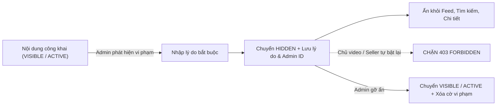

# TÀI LIỆU BẢO VỆ DỰ ÁN & BÀI THUYẾT TRÌNH (SLIDES)
**Họ và tên:** Bùi Duy Hoàng  
**Mã sinh viên:** B25DTCN093  
**Dự án:** ClipShop AI / TokFlow  
**Các mã task phụ trách:**
- **T3D2003**: Quản trị Admin: Duyệt người bán và quản lý tài khoản người dùng
- **T3D201D**: Quản trị Admin: Kiểm duyệt video, sản phẩm vi phạm và Dashboard thống kê Chart.js
- **T3D1D6C**: Xây dựng tài liệu kiểm thử toàn diện (Test Cases, Test Log, Bug Log)
- **T3D1DB4**: Tích hợp luồng xuyên suốt hệ thống, xử lý lỗi tích hợp và chuẩn bị bảo vệ / demo

---

## SLIDE 1: GIỚI THIỆU PHẠM VI CÔNG VIỆC PHỤ TRÁCH

### Tiêu đề: MODULE QUẢN TRỊ ADMIN VÀ KIỂM THỬ TÍCH HỢP HỆ THỐNG
**Người thực hiện:** Bùi Duy Hoàng (B25DTCN093)

#### Nội dung chính:
- **T3D2003: Phân quyền & Quản trị tài khoản:**
  - Quy trình xét duyệt đơn đăng ký bán hàng (nâng cấp role `USER` → `SELLER`).
  - Quản lý danh sách, tìm kiếm và kiểm soát trạng thái tài khoản (`ACTIVE` / `LOCKED`).
  - Gỡ bỏ hoàn toàn lỗ hổng tự duyệt quyền bán hàng (`quick-setup`).
- **T3D201D: Kiểm duyệt nội dung & Dashboard phân tích:**
  - Cơ chế kiểm duyệt nội dung vi phạm: Ẩn/Hiện video và sản phẩm kèm lý do vi phạm bắt buộc.
  - Chặn người bán và chủ video tự ý hiển thị lại nội dung đã bị Admin ẩn.
  - Dashboard thống kê thời gian thực: 6 chỉ số nền tảng và 3 biểu đồ Chart.js theo khoảng ngày.
- **T3D1D6C & T3D1DB4: Đảm bảo chất lượng & Tích hợp:**
  - 52 tình huống kiểm thử (Test Cases), 55 lượt chạy thực tế (Test Log) và theo dõi 3 lỗi (Bug Log).
  - Kiểm thử tích hợp xuyên suốt luồng người mua - người bán - quản trị viên (165 unit/integration tests).

> **Lời thoại thuyết trình (Speaker Notes):**  
> *"Kính thưa quý thầy cô và hội đồng, trong dự án ClipShop AI, em phụ trách toàn bộ phân hệ Quản trị Admin (gồm duyệt người bán, quản lý tài khoản, kiểm duyệt nội dung video, sản phẩm và dashboard phân tích doanh thu), đồng thời đảm nhiệm công tác kiểm thử tích hợp chất lượng luồng hệ thống. Sau đây em xin báo cáo chi tiết từng phần việc."*

---

## SLIDE 2: DUYỆT ĐƠN BÁN HÀNG & QUẢN TRỊ TÀI KHOẢN (TASK T3D2003)

### Kiến trúc & Nghiệp vụ cốt lõi:
1. **Duyệt đơn đăng ký bán hàng (`/api/admin/seller-applications`)**:
   - **Giao dịch nguyên tử (Atomic Transaction)**: Khi Admin duyệt đơn (`APPROVED`), việc cập nhật trạng thái đơn và chuyển đổi quyền người dùng sang `SELLER` diễn ra trong cùng một transaction. Nếu một bên lỗi, hệ thống tự động Rollback hoàn toàn để tránh lệch dữ liệu.
   - **Từ chối có lý do**: Bắt buộc nhập lý do từ chối (validate tối thiểu 1 ký tự thực tế, cấm khoảng trắng). Lưu lý do và ID Admin kiểm duyệt vào database.
   - **Xử lý xung đột**: Đơn đã duyệt hoặc từ chối sẽ bị khóa, không cho phép xử lý lại (trả về `409 Conflict`).
2. **Quản trị tài khoản (`/api/admin/users`)**:
   - **Chặn truy cập thời gian thực**: Khi tài khoản bị chuyển sang `LOCKED`, người đó bị chặn đăng nhập ngay lập tức. Quan trọng hơn, **mọi token cũ đang lưu hành đều bị từ chối truy cập 403 Forbidden** (nhờ cơ chế kiểm tra trạng thái user trực tiếp trong `get_current_user`).
   - **Bảo vệ quyền Admin**: Chặn Admin tự khoá chính mình (trả về `400 Bad Request`) để tránh mất quyền quản trị hệ thống.
   - **Tìm kiếm an toàn**: Hỗ trợ tìm kiếm theo username, email, tên hiển thị; escape an toàn các ký tự wildcard `%` và `_`.

> **Speaker Notes:**  
> *"Điểm quan trọng trong phần này là tính nhất quán dữ liệu: khi duyệt đơn, quyền SELLER và trạng thái đơn phải cùng thành công hoặc cùng thất bại. Đồng thời, cơ chế khóa tài khoản vô hiệu hóa ngay lập tức các token cũ mà không cần chờ token hết hạn, đảm bảo an toàn tuyệt đối cho sàn."*

---

## SLIDE 3: KIỂM DUYỆT VIDEO VÀ SẢN PHẨM VI PHẠM (TASK T3D201D)

### Quy trình kiểm duyệt hai chiều:

#### Các chốt chặn bảo mật then chốt:
1. **Lý do vi phạm bắt buộc**: API `PATCH /visibility` và modal giao diện bắt buộc nhập lý do cụ thể khi ẩn.
2. **Ngăn chặn chủ nội dung tự ý hiển thị lại**:
   - **Sản phẩm**: Seller gọi `PATCH /api/products/{id}` để kích hoạt lại sản phẩm bị Admin ẩn sẽ bị chặn `403 Forbidden`.
   - **Video**: Chủ video gọi `PATCH /api/videos/{id}/status` cũng bị chặn `403 Forbidden` nếu cờ `moderated_at` còn tồn tại. Chỉ duy nhất Admin có thẩm quyền gỡ ẩn.
3. **Hiệu ứng tức thì phía người mua**:
   - Sản phẩm bị ẩn không thể xem chi tiết (`404 Not Found`).
   - Giỏ hàng từ chối thêm sản phẩm bị ẩn (`400 Bad Request`).
   - Không thể đặt hàng sản phẩm bị ẩn.

---

## SLIDE 4: DASHBOARD THỐNG KÊ & PHÂN TÍCH DOANH THU CHART.JS

### 1. 6 Chỉ số nền tảng (Real-time Metric Cards):
- 👥 **Người dùng**: Tổng số tài khoản trên sàn.
- 🏪 **Người bán**: Số lượng tài khoản có quyền `SELLER`.
- 🎬 **Tổng Video**: Số video đã tải lên nền tảng.
- 🛍️ **Tổng Sản phẩm**: Tổng số mặt hàng đang quản lý.
- 📦 **Tổng Đơn hàng**: Tổng số giao dịch đặt hàng phát sinh.
- 💰 **Doanh thu toàn sàn**: Tổng số tiền các đơn hàng giao dịch thành công.

### 2. Quy tắc tính toán doanh thu chuẩn xác:
- **Trạng thái hợp lệ**: Chỉ tính các đơn đã thanh toán/xác nhận (`confirmed`), đang giao (`shipping`) hoặc hoàn tất (`completed`).
- **Loại trừ đơn rác**: Hoàn toàn loại bỏ đơn chờ thanh toán (`pending`) và đơn đã hủy (`cancelled`).
- **Chống cộng trùng (Zero Double-Counting)**: Truy vấn trực tiếp `SUM(total_amount)` trên bảng `orders` (không join nhân bản theo `order_items`), bảo đảm một đơn hàng chứa nhiều mặt hàng vẫn chỉ được tính đúng giá trị đơn hàng 1 lần duy nhất.

### 3. Tương tác trực quan với Chart.js:
- **Biểu đồ 1**: Doanh thu toàn sàn theo ngày (₫) (Line Chart).
- **Biểu đồ 2**: Số lượng đơn hàng theo ngày (Bar Chart).
- **Biểu đồ 3**: Người dùng & Video mới theo ngày (Multi-line Chart).
- **Bộ lọc thời gian**: Linh hoạt chọn khoảng "Từ ngày – Đến ngày" hoặc các nút chọn nhanh 7, 14, 30, 90 ngày. Bắt lỗi logic nếu Từ ngày > Đến ngày hoặc khoảng thời gian > 365 ngày.

---

## SLIDE 5: QUÁ TRÌNH KIỂM THỬ & CÁC LỖI ĐÃ PHÁT HIỆN, KHẮC PHỤC

### Minh bạch lỗi phát hiện trong quá trình tích hợp (Bug Log):
| Mã Bug | Mô tả lỗi phát hiện | Mức độ | Nguyên nhân | Cách khắc phục & Kết quả |
|---|---|:---:|---|---|
| **BUG-01** | Chủ video vẫn tự bật lại được video bị Admin ẩn | **High** | API cũ `/api/videos/{id}/status` chỉ kiểm tra quyền sở hữu mà chưa kiểm tra cờ `moderated_at`. | Bổ sung kiểm tra `moderated_at IS NOT NULL`: chặn 403 đối với non-admin. *(Retest: PASS)* |
| **BUG-02** | Request body rỗng `{}` gửi đến `/visibility` tự động chạy nhánh "hiện lại" | **Medium** | Schema cho phép cả `status` và `is_visible` là `None`. | Áp dụng `model_validator` bắt buộc chọn trạng thái và bắt lỗi mâu thuẫn -> trả về 422. *(Retest: PASS)* |
| **BUG-03** | Tên video/sản phẩm chứa ký tự nháy kép `"` làm vỡ thuộc tính `data-name` | **Medium** | `escapeHtml` chỉ dựa vào `div.innerHTML` nên không escape ký tự nháy kép. | Viết hàm chuyên biệt `escapeAttr()` mã hóa `"` thành `"` và `'` thành `'`. *(Retest: PASS)* |
| **BUG-04** | Tài khoản USER chưa có cửa hàng gọi `/api/shops/me/orders` trả về 404 thay vì 403 Forbidden | **Medium** | Hàm `_get_owned_shop_or_404()` ném ngay 404 mà chưa kiểm tra vai trò người bán đã duyệt. | Bổ sung kiểm tra `_is_approved_seller(db, user)`; trả về 403 chuẩn RBAC cho non-seller. *(Retest: PASS)* |
| **BUG-05** | Video bị Admin ẩn vi phạm vẫn cho phép thả tim (like), đăng bình luận mới và xem bình luận | **High** | API likes và comments chỉ gọi `check_video()` (kiểm tra tồn tại) mà chưa kiểm tra cờ `status == HIDDEN`. | Thêm hàm `check_video_available()`; chặn 400 Bad Request cho like, comment và xem comment trên video ẩn. *(Retest: PASS)* |

> **Speaker Notes:**  
> *"Trong quá trình kiểm thử, em chủ động tìm kiếm các trường hợp biên và lỗ hổng bảo mật. Việc phát hiện sớm 3 lỗi trên và viết test tự động hồi quy giúp hệ thống đạt độ tin cậy và an toàn cao nhất trước khi bàn giao."*

---

## SLIDE 6: KẾT QUẢ KIỂM THỬ THỰC TẾ (T3D1D6C)

### Báo cáo số liệu kiểm thử:
- **Tài liệu kiểm thử**: File Excel `T3D1D6C_TestCase_TestLog_BuiDuyHoang_B25DTCN093.xlsx` gồm 3 sheet (`Test Cases`, `Test Log`, `Bug Log`).
- **Tổng số Test Cases**: **52 tình huống** bao phủ 100% chức năng Admin, phân quyền, bảo mật và logic tính toán.
- **Tổng số lần thực thi (Test Log)**: **55 lượt kiểm thử** (kèm bằng chứng chi tiết).
- **Kết quả kiểm thử cuối cùng**: **52/52 Test Cases PASSED (100%)**.
- **Quản lý lỗi (Bug Log)**: **5 lỗi (BUG-01 → BUG-05)** được phát hiện và khắc phục triệt để (100% Closed).

### Kiểm thử tự động với Pytest (Backend):
- **Bộ test Admin & Moderation (`test_admin.py`, `test_admin_moderation.py`)**: 39 tests Passed.
- **Bộ test Social & Permissions (`test_social.py`)**: 19 tests Passed.
- **Bộ test luồng xuyên suốt E2E (`test_e2e_full_flow.py`)**: 1 test toàn diện Passed.
- **Toàn bộ test suite dự án**: **176 tests Passed (0 lỗi)** sau khi tích hợp toàn bộ các nhánh.

### Kiểm thử luồng tích hợp xuyên suốt trực tiếp (Live HTTP E2E Flow):
- **Script chạy**: `python e2e_live_flow.py --reset --base http://127.0.0.1:8000` (hoặc cổng 8001).
- **Phạm vi kiểm thử**: Chuỗi thực tế qua HTTP & MySQL từ Đăng ký → Đăng nhập → Nộp đơn bán hàng → Admin duyệt → Tạo shop → Thêm sản phẩm & video → Khách thêm giỏ → Đặt hàng → Admin ẩn vi phạm → Chặn chủ shop tự bật lại → Khoá/Mở khoá tài khoản → Dashboard thống kê.
- **Kết quả kiểm thử thực tế**: **105/105 Tình huống PASSED (100% PASS, 0 FAIL)**. Ghi log tại `e2e_live_results.json`.

---

## SLIDE 7: KỊCH BẢN DEMO LUỒNG XUYÊN SUỐT (LIVE DEMO)

### Trình tự demo thực tế (5 bước chuẩn bị sẵn dữ liệu mẫu):
1. **Duyệt người bán (T3D2003)**:
   - Đăng nhập tài khoản `admin01`.
   - Mở tab *Đơn đăng ký bán hàng*, thấy đơn của `seller_candidate` (Shop GenZ Fashion).
   - Thử bấm "Từ chối" không nhập lý do -> hệ thống bắt lỗi. Bấm "Duyệt" -> đơn được duyệt thành công, tài khoản nhận quyền `SELLER`.
2. **Quản lý tài khoản (T3D2003)**:
   - Mở tab *Tài khoản*, tìm kiếm tài khoản `user_normal`.
   - Bấm nút "Khoá" -> trạng thái đổi sang `LOCKED`.
   - Thử đăng nhập tài khoản đó trên tab ẩn danh -> hệ thống báo "Tài khoản đã bị khóa".
   - Quay lại Admin bấm "Mở khoá" -> tài khoản đăng nhập lại bình thường.
3. **Kiểm duyệt video & sản phẩm (T3D201D)**:
   - Mở tab *Video*, thấy video review của shop. Bấm "Ẩn vi phạm", nhập lý do "Bản quyền âm nhạc".
   - Mở tab *Sản phẩm*, bấm ẩn sản phẩm vi phạm.
   - Xác nhận sản phẩm bị ẩn không thể xem chi tiết hoặc thêm vào giỏ.
   - Thử dùng tài khoản seller tự bật lại -> bị báo lỗi không đủ quyền.
4. **Xem Dashboard & Doanh thu (T3D201D)**:
   - Mở tab *Dashboard*, kiểm tra 6 thẻ số liệu: Doanh thu hiển thị chuẩn xác (đã loại bỏ đơn hủy).
   - Đổi bộ lọc ngày (ví dụ 7 ngày, 30 ngày) -> biểu đồ Chart.js cập nhật trực quan tức thì.
5. **Tổng kết**:
   - Khẳng định toàn bộ tính năng hoạt động đồng bộ, giao diện thân thiện, mã nguồn đáp ứng đúng chuẩn dự án.
